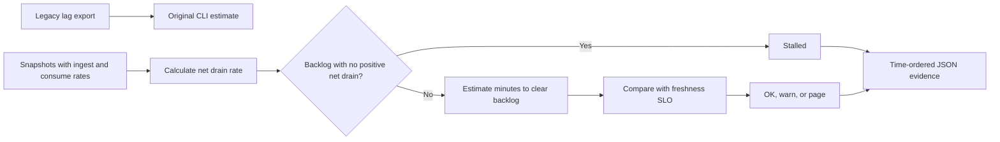

# Kafka Consumer Lag SLO Guard

A consumer group can process messages without shrinking its backlog. Responders need to distinguish stalled recovery from a backlog that will clear within the freshness target.

## What I built

I built a Kafka freshness review CLI and a replay mode for time-ordered snapshots. Replay subtracts ingest rate from consumer throughput and marks an existing backlog stalled when net drain is zero or negative. Otherwise it compares the estimated catch-up time to the SLO.

## How it works



[Architecture](docs/ARCHITECTURE.md) · [Decision rules and source](docs/RULES.md)

## Tools used

| Tool | Role in this repository |
| --- | --- |
| Python | [lag_guard.py](lag_guard.py) implements the CLI and decision rules. Uses `csv` to read tabular exports. |
| Make | Runs the documented example and the local `unittest` suite. |
| Python replay runner | Compares actual stdout with the checked-in baseline fixtures. |
| Ruff and Bandit | Developer lint and static security checks through `make check`. |

## Run the project

Use Python 3.10+ and Make. From the repository root:

```sh
python3 lag_guard.py sample_lag.csv
```

The basic sample emits warnings for two groups. Replay adds measured drain rate and decision evidence for each snapshot. [Full expected output](examples/Demo%201.stdout.txt)

### Additional replay cases

- **Demo 2** · `python3 replay.py examples/replay.csv` · [Expected output](examples/Demo%202.stdout.txt)

## Verify the project

```sh
make verify
make replay
```

`make replay` checks the recorded cases and exits nonzero if the output changes.
See the [developer guide](docs/DEVELOPMENT.md) for the pinned lint and security tools.

## Operating limits

The basic CLI uses ingest rate as a proxy. Use replay with measured throughput for recovery estimates. Both modes work on local exports and send no pages.

[Case study](docs/CASE_STUDY.md) · [Operator runbook](docs/RUNBOOK.md) · [Verification report](reports/verification.md)
