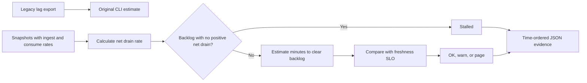

# Kafka Consumer Lag SLO Guard

SRE utility for AI/ML streaming platforms that flags Kafka consumer groups at risk of missing freshness SLOs.

Focus: Kafka, platform engineering, model-feature freshness, SRE.

Uses synthetic Kafka snapshots to explain freshness risk and catch-up decisions.

## Run

```bash
python3 lag_guard.py sample_lag.csv
```

## Verify

```bash
python3 -m unittest discover . -v
```

## Local verification

Run `make verify` with Make and Python 3 installed. The target runs the documented sample through the project CLI. It also runs the existing Python unit tests.

## Business problem

A consumer group can process messages without shrinking its backlog. Responders need to distinguish stalled recovery from a backlog that will clear within the freshness target.

## Project walkthrough



[Architecture and data flow](docs/ARCHITECTURE.md) · [Business problem, demo, and verification](docs/CASE_STUDY.md)

## Replay an incident

Run `python3 replay.py examples/replay.csv` to see a stalled group, an SLO breach, and recovery in one replay. `make verify` tests all three outcomes.

## Run the project

### Local setup

Run `make verify` with Python 3 and Make installed.

### CLI usage

```sh
python3 lag_guard.py sample_lag.csv
```

### Replay usage

Run `make replay` to replay the checked-in inputs. The runner compares stdout with the baseline, reports differences, and exits nonzero on regression.

[Replay cases](examples/replay-manifest.json) · [Generated report](reports/replay.md) · [Rule implementation](docs/RULES.md)

### Run tests

[Verification report](reports/verification.md) · [Business problem, sample behavior, and limitations](docs/CASE_STUDY.md)

### Container demo

The [Dockerfile](infra/Dockerfile) packages the CLI and its synthetic input.
Runs the synthetic stall, breach, and recovery timeline.

```sh
docker build -f infra/Dockerfile -t kafka-consumer-lag-slo-guard:local .
docker run --rm --network none kafka-consumer-lag-slo-guard:local
```

Local Python verification passed. The container build and execution were
outside this environment's verification.

### Limitations

The verification report covers the bundled local examples. See the [case study](docs/CASE_STUDY.md) for project-specific assumptions and operating limits.
