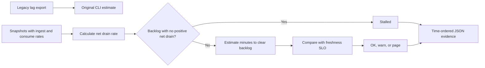

# Kafka Consumer Lag SLO Guard

SRE utility for AI/ML streaming platforms that flags Kafka consumer groups at risk of missing freshness SLOs.

Focus: Kafka, platform engineering, model-feature freshness, SRE.

Uses synthetic Kafka snapshots to explain freshness risk and catch-up decisions.

## Run

```bash
python3 lag_guard.py sample_lag.csv
```

## Verify

```bash
python3 -m unittest discover . -v
```

## Local verification

Run `make verify` with Make and Python 3 installed. The target runs the documented sample through the project CLI. It also runs the existing Python unit tests.

## Business problem

A consumer group can process messages without shrinking its backlog. Responders need to distinguish stalled recovery from a backlog that will clear within the freshness target.

## Project walkthrough



[Architecture and data flow](docs/ARCHITECTURE.md) · [Business problem, demo, and verification](docs/CASE_STUDY.md)

## Replay an incident

Run `python3 replay.py examples/replay.csv` to see a stalled group, an SLO breach, and recovery in one replay. `make verify` tests all three outcomes.
