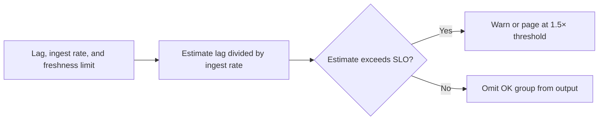

# Kafka Consumer Lag SLO Guard

SRE utility for AI/ML streaming platforms that flags Kafka consumer groups at risk of missing freshness SLOs.

Focus: Kafka, platform engineering, model-feature freshness, SRE.

Portfolio framing: Apple-scale client-style reliability project using synthetic data only.

## Run

```bash
python3 lag_guard.py sample_lag.csv
```

## Verify

```bash
python3 -m unittest discover . -v
```

## Local verification

Run `make verify` with Make and Python 3 installed. The target runs the documented sample through the project CLI. It also runs the existing Python unit tests.

## Project walkthrough



[Architecture and data flow](docs/ARCHITECTURE.md) · [Business problem, demo, and verification](docs/CASE_STUDY.md)
