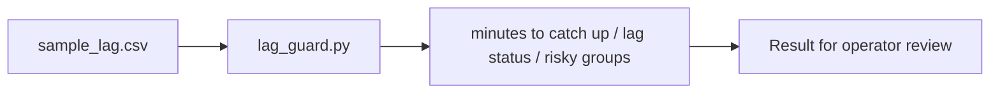

# Kafka Consumer Lag Slo Guard architecture

SRE utility for AI/ML streaming platforms that flags Kafka consumer groups at risk of missing freshness SLOs.

## Operational boundaries

The documented run evaluates the bundled sample locally. Results depend on the quality and scope of the input. The demo makes no live infrastructure changes.
